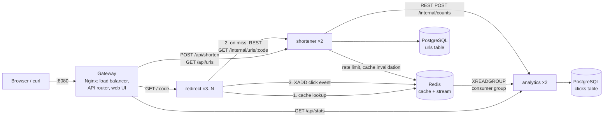

# Snip: Distributed URL Shortener

A microservice URL shortener that runs on **Docker Compose** and **Kubernetes**. It demonstrates
horizontal scalability, load balancing, caching, inter-service communication (both synchronous REST
and an asynchronous message queue), and fault tolerance.

Mini Project: Distributed Systems

---

## 1. Architecture



| Component | Role | Replicas | Owns |
|---|---|---|---|
| **gateway** (Nginx) | Single entry point. Serves the UI, routes `/api/*` to the owning service, round-robins across replicas, retries failed replicas | 1 (compose) / 2 (k8s) | none |
| **shortener** (Node/Express) | Create / list / delete links, custom aliases, expiry, distributed rate limit | 2 | `urls` table |
| **redirect** (Node/Express) | Hot path: resolves `/<code>` and sends a 302 redirect. Stateless, so it scales freely | 3 → 10 (HPA) | none |
| **analytics** (Node/Express) | Consumes click events from the queue and serves statistics | 2 | `clicks` table |
| **PostgreSQL 16** | Persistent storage (each service owns its own tables) | 1 | |
| **Redis 7** | Read cache, click-event stream (message queue), shared rate-limit counters | 1 | |

### Request flows

**Create link:** `POST /api/shorten` → gateway → *any* shortener replica → `nextval()` on a Postgres
sequence → encode as a 7-char base62 code → insert → delete any stale cache entry → `201`.

**Follow link:** `GET /k8s-docs` → gateway → *any* redirect replica →
1. Redis `GET url:k8s-docs` (**cache hit**: no DB or network hop)
2. on a miss: REST call to the shortener's internal API, then cache the result (TTL 1h, or 30s for "not found")
3. `302 Location: …` back to the user immediately
4. *in the background*: `XADD clicks` event → an analytics replica consumes it → stored in Postgres

---

## 2. Distributed-systems concepts and where they are implemented

| Concept | Implementation | File |
|---|---|---|
| **Microservices** | 3 independently deployable services, each owning its own data | `services/*` |
| **Synchronous inter-service REST** | redirect → shortener (`/internal/urls/:code`), shortener → analytics (`/internal/counts`) | `redirect/src/index.js`, `shortener/src/index.js` |
| **Asynchronous messaging** | Click events go through a **Redis Stream**, so redirects never wait for analytics | `redirect/src/index.js` `recordClick()` |
| **Load balancing** | Nginx round-robins across all replica IPs (Docker DNS) or a k8s Service | `gateway/nginx/default.conf.template` |
| **Horizontal scaling** | `docker compose up --scale redirect=5`; Kubernetes **HPA** autoscales on CPU | `docker-compose.yml`, `k8s/hpa.yaml` |
| **Competing consumers** | Analytics replicas share one **consumer group**, so each event is processed by exactly one replica | `analytics/src/consumer.js` |
| **Distributed ID generation** | Atomic Postgres sequence + a bijective base62 scramble give unique, non-guessable codes across all replicas | `shortener/src/codegen.js` |
| **Caching** | Redis read-through cache with TTL, negative caching, and invalidation on create/delete | `redirect/src/index.js` `lookup()` |
| **Distributed rate limiting** | Counter in Redis shared by all shortener replicas (a per-process counter could be bypassed) | `shortener/src/index.js` `rateLimit()` |
| **Fault tolerance** | Gateway retries another replica; services degrade gracefully when a dependency is down (see §5) | throughout |
| **At-least-once delivery + idempotency** | Ack after DB write; un-acked events reclaimed with `XAUTOCLAIM`; duplicate events ignored via a `UNIQUE(event_id)` constraint | `analytics/src/consumer.js` |
| **Health checks / self-healing** | `/live` + `/health` endpoints; Docker healthchecks; k8s startup/liveness/readiness probes restart or isolate bad pods | all services, `k8s/*.yaml` |
| **Concurrent schema migration** | Every replica migrates on boot under a Postgres advisory lock (no race conditions) | `*/src/db.js` |
| **Graceful shutdown** | `SIGTERM` closes the HTTP server and connections cleanly (zero-downtime rolling updates) | all services |

---

## 3. Run with Docker Compose

Requirements: Docker Desktop (or Docker Engine + Compose v2).

```bash
docker compose up -d --build
```

Open **http://localhost:8080**. This starts 10 containers: gateway, 2× shortener, 3× redirect,
2× analytics, Postgres and Redis.

```bash
docker compose ps                       # status and health of every container
docker compose logs -f redirect         # follow one service's logs (all replicas)
docker compose down                     # stop (keeps data)
docker compose down -v                  # stop and delete data volumes
```

### Scale out / in (no restart needed: nginx re-resolves replicas every 5s)

```bash
docker compose up -d --scale redirect=5 --no-recreate
docker compose up -d --scale analytics=4 --no-recreate
```

### Load test

```bash
node loadtest/loadtest.js --duration 20 --concurrency 50
node loadtest/loadtest.js --code k8s-docs --mode resolve
```

It prints throughput, p50/p95/p99 latency, status codes, cache hit ratio and the
**request distribution per replica** (from the `X-Served-By` response header).

---

## 4. Run on Kubernetes

The manifests live in `k8s/` (namespace `urlshort`): Deployments + Services for every component,
a Secret and ConfigMap, a PVC for Postgres, startup/readiness/liveness probes, preStop hooks, resource limits, a
**LoadBalancer** gateway and **HorizontalPodAutoscalers**.

### Option A: Docker Desktop Kubernetes (easiest on Windows)

1. Docker Desktop → *Settings → Kubernetes → Enable Kubernetes* → *Apply & restart*.
   If the Docker VM has little memory (under ~4 GB), first run `docker compose stop`, or the control
   plane can time out while starting.
2. Build the images:
   ```bash
   docker compose build
   ```
3. **kind mode only** (Docker Desktop's default on new installs; check with `docker desktop kubernetes status`):
   the cluster has its own image store, so copy the images into the node:
   ```bash
   for img in shortener redirect analytics gateway; do docker save urlshort/$img:1.0 | docker exec -i desktop-control-plane ctr -n k8s.io images import -; done
   ```
4. Deploy:
   ```bash
   kubectl apply -k k8s/
   kubectl get pods -n urlshort -w
   ```
5. Open **http://localhost:30080** (the gateway is a `LoadBalancer` Service, which Docker Desktop publishes on localhost).

### Option B: minikube

```bash
minikube start
minikube image load urlshort/shortener:1.0 urlshort/redirect:1.0 urlshort/analytics:1.0 urlshort/gateway:1.0
kubectl apply -k k8s/
minikube service gateway -n urlshort --url      # prints the URL to open
```
(For standalone **kind**, use `kind load docker-image <image>` for each image instead.)

### Autoscaling demo (HPA)

The HPA needs **metrics-server**:
```bash
# minikube
minikube addons enable metrics-server
# Docker Desktop
kubectl apply -f https://github.com/kubernetes-sigs/metrics-server/releases/latest/download/components.yaml
kubectl patch deployment metrics-server -n kube-system --type=json -p='[{"op":"add","path":"/spec/template/spec/containers/0/args/-","value":"--kubelet-insecure-tls"}]'
```
Then, in two terminals:
```bash
kubectl get hpa -n urlshort -w
```
```bash
node loadtest/loadtest.js --base http://localhost:30080 --duration 180 --concurrency 150
```
CPU on the redirect pods rises above 50%, and Kubernetes adds pods. About a minute after the load stops,
it scales back down. Measured run (`--mode resolve --concurrency 100`, 90 s):

| Time | Redirect CPU (target 50%) | Redirect replicas | Shortener replicas |
|---|---|---|---|
| 15 s | 3% | 3 | 2 |
| 30 s | 88% | 3 → scaling | 2 |
| 45 s | 399% | 6 | 2 |
| 60 s | 421% | **10** (max) | 2 |

30,643 requests at ~340 req/s with 0 errors. Every new pod immediately took its share of traffic. Only the
service under load scaled: the shortener stayed at 2.

Note: CPU *requests* must be realistic (100m here). With 50m, a new Node.js pod's start-up CPU spike
looked like 500%+ utilisation and caused a scale-up feedback loop. The shortener HPA also has a 30 s
scale-up stabilisation window for the same reason.

### Zero-downtime details
- **startupProbe** gives a pod up to 3 minutes to boot (e.g. while Postgres is still starting) before the
  liveness probe can restart it.
- A **preStop** `sleep 5` keeps a terminating pod serving until it has been removed from the Service
  endpoints. Without it, deleting a pod under load produced ~1.5% 502 errors; with it, deleting a redirect
  pod *and* a gateway pod mid-load gave **0 errors** in 1,588 requests.
- **Rolling updates**: `kubectl apply` with a changed manifest replaces pods one by one with no failed requests.

### Useful commands
```bash
kubectl get all -n urlshort
kubectl scale deployment redirect -n urlshort --replicas=6     # manual scaling
kubectl delete pod -n urlshort -l app=redirect --wait=false     # kill pods, watch them self-heal
kubectl logs -n urlshort -l app=analytics -f
kubectl rollout restart deployment redirect -n urlshort          # zero-downtime rolling restart
kubectl delete namespace urlshort                               # remove everything
```

---

## 5. Demo script (fault-tolerance scenarios)

Scenarios 1-9 were run against the Compose deployment; 10-11 on Kubernetes.

| # | Scenario | Command | Expected (and observed) result |
|---|---|---|---|
| 1 | **Load balancing** | UI → *Load-balancing demo* → *Send requests*, or `node loadtest/loadtest.js` | Requests split ~33% / 33% / 33% across the 3 redirect replicas |
| 2 | **Scale out** | `docker compose up -d --scale redirect=5 --no-recreate` | New replicas take traffic within seconds (~20% each), no restart |
| 3 | **Replica crash under load** | `docker kill url-shortener-redirect-2` during a load test | **0 failed requests**: nginx retries the next replica |
| 4 | **Analytics down** | `docker compose stop analytics` | Redirects keep working. The links list shows "analytics unavailable". Clicks **queue up in the stream** (backlog grows) |
| 5 | **Analytics recovers** | `docker compose start analytics` | The backlog drains to 0 and **no clicks are lost** |
| 6 | **Shortener down** | `docker compose stop shortener` | **Cached** links still redirect (served from Redis); uncached links return a friendly 503 |
| 7 | **Redis down** | `docker compose stop redis` | Redirects still work (cache bypassed, falls back to the shortener REST API). Clicks are sent to analytics over **direct REST** instead of the queue: 0 dropped |
| 8 | **Link expiry** | Create a link with "Expires in 2 minutes" | After 2 min it returns `410 Gone` |
| 9 | **Rate limiting** | Create > 30 links in a minute | `429 Too Many Requests`, enforced across all shortener replicas |
| 10 | **Pod deleted under load (k8s)** | `kubectl delete pod -n urlshort <redirect-pod>` during a load test | Kubernetes recreates it within seconds; **0 failed requests** |
| 11 | **Autoscaling (k8s)** | Load test + `kubectl get hpa -n urlshort -w` | Redirect scales 3 → 10 pods in under a minute |

Measured on a laptop (Docker Desktop on Windows, 30 concurrent connections): ~135 redirects/s, 100% cache-hit
ratio after warm-up, even spread across replicas, and every click accounted for in analytics.

---

## 6. API reference (through the gateway, port 8080)

| Method | Path | Service | Description |
|---|---|---|---|
| `POST` | `/api/shorten` | shortener | Body `{ "url": "...", "alias"?: "my-link", "expiresInMinutes"?: 60 }` → `201` with `code`, `shortUrl` |
| `GET` | `/api/urls?limit=20` | shortener | Recent links with click counts (counts are fetched from analytics) |
| `DELETE` | `/api/urls/:code` | shortener | Delete a link and invalidate its cache entry |
| `GET` | `/:code` | redirect | `302` to the original URL (`404` unknown, `410` expired). Headers `X-Served-By`, `X-Cache` |
| `GET` | `/api/resolve/:code` | redirect | JSON lookup without counting a click (used by the LB demo) |
| `GET` | `/api/stats` | analytics | Cluster overview: totals, per-replica counts, queue backlog, consumers |
| `GET` | `/api/stats/:code` | analytics | Per-link stats: total, clicks per minute (last hour), referrers, replicas |
| `GET` | `/health/{shortener,redirect,analytics}` | each | Health of one replica (instance id, dependencies) |

`/internal/*` endpoints are for service-to-service calls only. The gateway blocks them from outside.

```bash
curl -X POST localhost:8080/api/shorten -H "content-type: application/json" \
     -d '{"url":"https://kubernetes.io/docs/","alias":"k8s-docs"}'
curl -I localhost:8080/k8s-docs
```

---

## 7. Project structure

```
url-shortener/
├── docker-compose.yml          # local multi-container deployment (with replicas)
├── gateway/                    # Nginx: load balancer + API gateway + static UI
│   ├── nginx/default.conf.template
│   └── public/                 # index.html, static/app.js, static/style.css
├── services/
│   ├── shortener/              # link creation, ID generation, rate limiting
│   ├── redirect/               # hot-path redirects, caching, event publishing
│   └── analytics/              # stream consumer group, statistics API
├── k8s/                        # Kubernetes manifests (kubectl apply -k k8s/)
│   ├── namespace.yaml  config.yaml  postgres.yaml  redis.yaml
│   ├── shortener.yaml  redirect.yaml  analytics.yaml  gateway.yaml
│   ├── hpa.yaml  kustomization.yaml
└── loadtest/loadtest.js        # zero-dependency load generator
```

## 8. Design decisions

- **302 instead of 301:** browsers cache 301s permanently, so repeat clicks would never reach the server or be counted.
- **Separate read and write services:** redirects outnumber link creation by orders of magnitude, so the read path (redirect) scales independently of the write path (shortener).
- **Queue between redirect and analytics:** a slow or failed analytics service never slows down or breaks a redirect, and traffic spikes are absorbed by the stream.
- **Sequence-based IDs instead of random/hash:** guaranteed unique with no collision checks or retries across replicas. The multiplicative scramble hides the sequential order.
- **Single Postgres instance:** a deliberate simplification for the project. Services still own separate tables and talk only through APIs, so splitting into separate databases (or adding read replicas) would need no code changes outside `DATABASE_URL`.

### Possible extensions
Postgres read replicas / sharding by code, Redis Sentinel or Cluster for HA, Prometheus + Grafana metrics, QR codes, user accounts.
